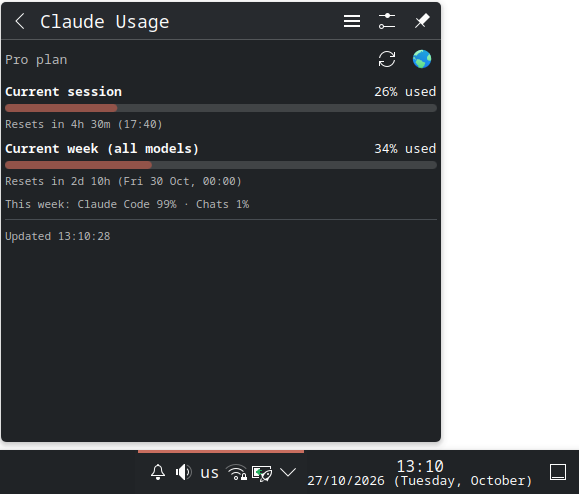

# Claude Usage - KDE Plasma 6 tray widget



Shows Claude plan usage limits (the same data as `/usage` in Claude Code) in the system tray.

- **Tray icon:** outer ring and number = current 5h session %, thin inner ring = weekly %.
  Accent color, orange from 75%, red from 90%.
- **Click:** popup with every limit, progress bar, reset countdown, weekly per-product breakdown.
- **Middle click:** refresh now. **Hover:** tooltip with all limits.
- Polls every 60 s (configurable) and on every popup open.

## How it works

`package/contents/code/fetch_usage.py` reads the OAuth token Claude Code stores in
`~/.claude/.credentials.json` (or `$CLAUDE_CONFIG_DIR`), calls
`GET https://api.anthropic.com/api/oauth/usage` (`anthropic-beta: oauth-2025-04-20`),
normalizes the response and prints one JSON line. The last good result is cached in
`~/.cache/claude-usage-plasmoid/usage.json`. The QML runs the script through the
Plasma5Support `executable` data engine.

The token is **never refreshed** by the widget: refresh tokens rotate, so refreshing would
log Claude Code out. When the token expires (~8 h without running `claude`) the widget
dims, keeps the last numbers (windows whose reset time passed show 0%) and recovers on its
own once Claude Code refreshes the token.

## Install

Requires KDE Plasma 6 and Python 3, and a Claude Code login (`claude` must have run once,
so `~/.claude/.credentials.json` exists).

```sh
git clone git@github.com:0r1k/claude-usage-plasmoid.git && cd claude-usage-plasmoid
./install.sh
```

The script installs (or upgrades) the plasmoid into `~/.local/share/plasma/plasmoids/`,
adds it to the system tray and restarts plasmashell, because the tray picks up new
widgets only on start. Options:

```sh
./install.sh --no-tray       # don't add to the system tray (add it to a panel yourself)
./install.sh --no-restart    # don't restart plasmashell, changes apply on next login
./install.sh --uninstall     # remove the plasmoid, its tray entry and cache
```

If the automatic tray setup fails, enable it in System Tray settings -> Entries -> *Claude Usage*.

Preview the popup without touching the shell: `plasmawindowed net.or1k.claudeusage`.

## Layout

```
package/
  metadata.json             plugin id net.or1k.claudeusage, X-Plasma-NotificationArea
  contents/code/fetch_usage.py
  contents/config/          main.xml (settings schema), config.qml
  contents/ui/              main.qml, CompactView.qml (tray ring), FullView.qml (popup), configGeneral.qml
```
